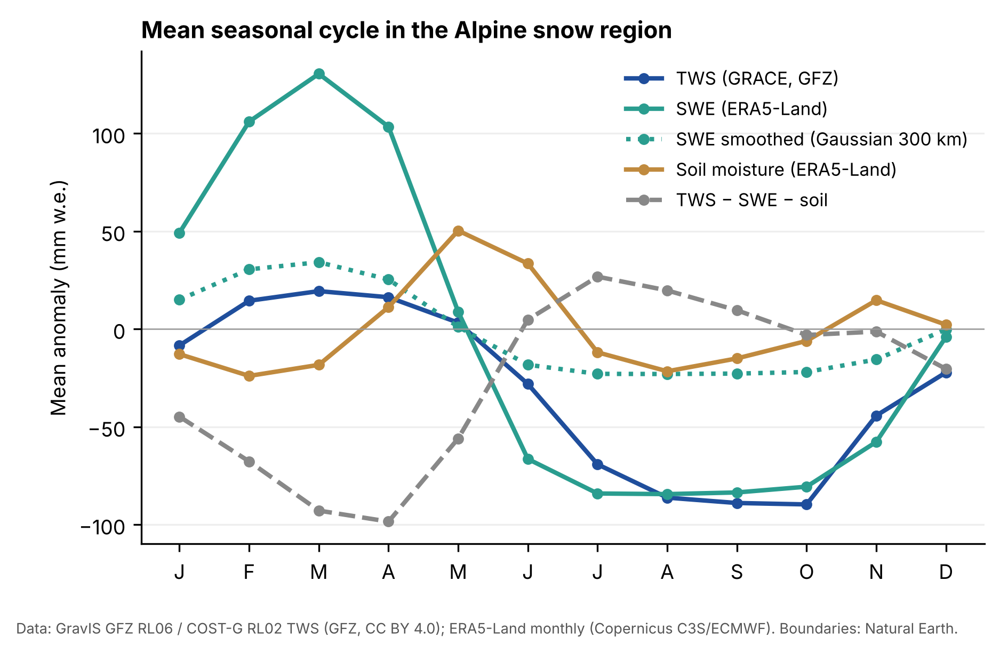
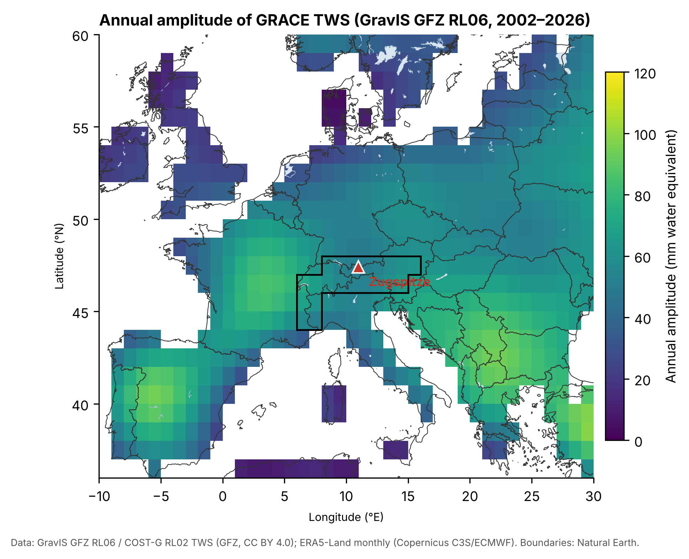
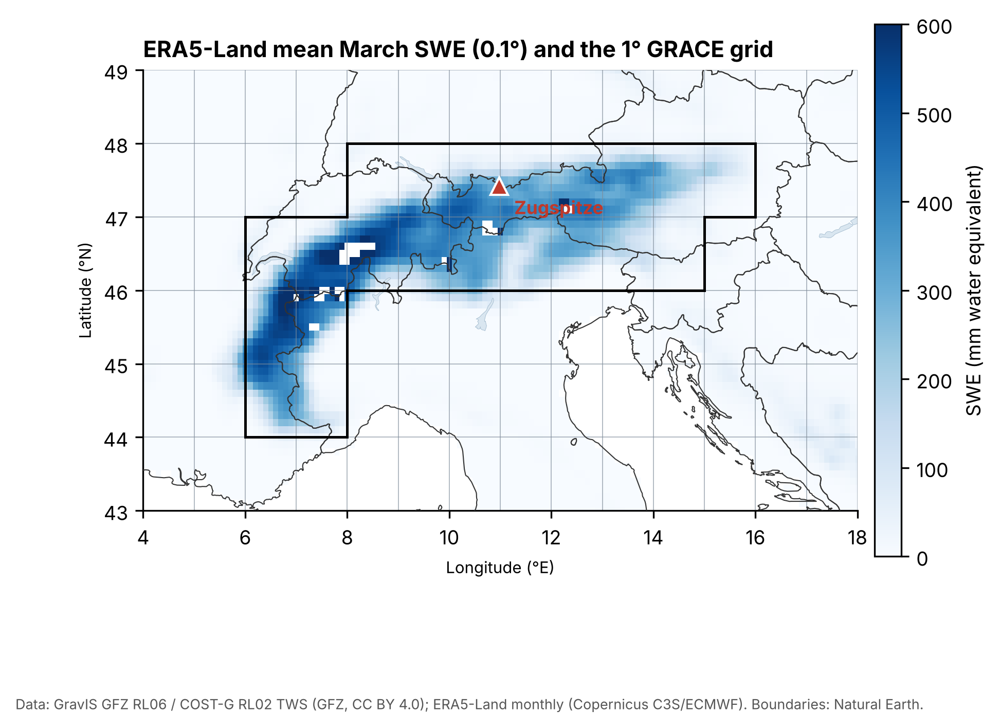
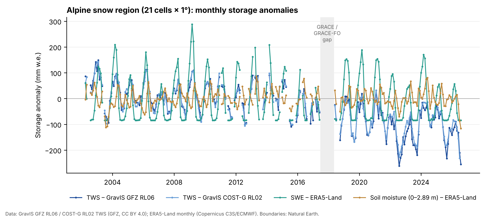
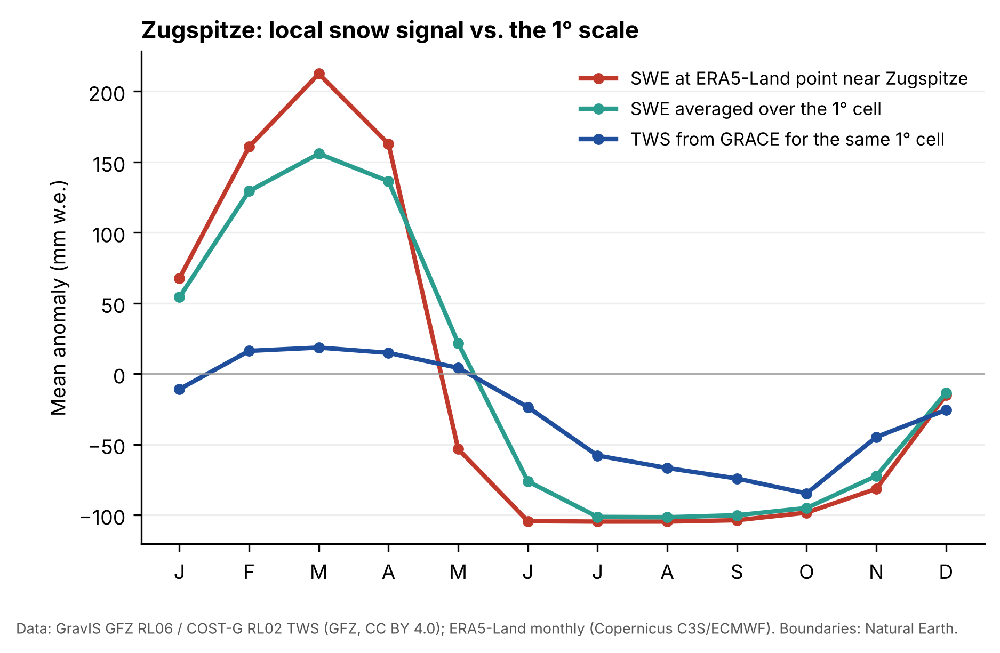

# Snow-related mass variations in the Alps from GRACE/GRACE-FO

How much of the seasonal water-storage signal that GRACE/GRACE-FO sees over the Alps is snow,
and what is lost at the scale of satellite gravimetry?

This project compares terrestrial water storage (TWS) anomalies from the GFZ Gravity Information
Service (GravIS; Dahle et al., 2025) with snow water equivalent (SWE) and soil moisture from the
ERA5-Land reanalysis (Muñoz-Sabater et al., 2021) for an Alpine study region (2002–2026), and
looks at the Zugspitze site as an example of the local scale.



## Background

GRACE (2002–2017; Tapley et al., 2004) and GRACE-FO (since 2018; Landerer et al., 2020) observe
monthly changes of the Earth's gravity field. Over land these are interpreted as changes in the
total water storage – snow, ice, soil moisture, groundwater and surface water together – using
the thin-layer approximation (Wahr et al., 1998). Because the monthly fields are noisy at short
wavelengths, they have to be filtered (Swenson & Wahr, 2006; Kusche, 2007), which limits the
spatial resolution to a few hundred km and spreads ("leaks") concentrated signals into their
surroundings (Landerer & Swenson, 2012). Mountain snow is exactly such a concentrated signal.
The ERC project SnowShifts addresses this scale gap by combining satellite gravimetry with
local superconducting gravimeters, e.g. at the Zugspitze (Voigt et al., 2021).

## Data

| Dataset | Use | Reference |
|---|---|---|
| GravIS GFZ RL06 Level-3 TWS, v0006 | main GRACE/GRACE-FO product | Boergens et al. (2019), [doi:10.5880/GFZ.GRAVIS_06_L3_TWS](https://doi.org/10.5880/GFZ.GRAVIS_06_L3_TWS) |
| GravIS COST-G RL02 Level-3 TWS, v0001 | second product (combined solution) | Boergens et al. (2025), [doi:10.5880/COST-G.GRAVIS_02_L3_TWS](https://doi.org/10.5880/COST-G.GRAVIS_02_L3_TWS) |
| ERA5-Land monthly means: SWE, soil water layers 1–4 | snow and soil moisture | C3S (2019), [doi:10.24381/cds.68d2bb30](https://doi.org/10.24381/cds.68d2bb30); Muñoz-Sabater et al. (2021) |
| Natural Earth 1:10m | borders, lakes | public domain |

**GravIS processing (from Dahle et al., 2025, the GravIS technical note and corrections page):**
1° grid over land; anomalies relative to the mean of 2002-04 to 2020-03; anisotropic VDK filters
(Kusche et al., 2009; Horvath et al., 2018); C20 (and partly C30) replaced by SLR-based estimates;
degree-1 terms added (Swenson et al., 2008); GIA removed with ICE-6G_D (Peltier et al., 2018);
non-tidal atmosphere and ocean removed with AOD1B RL06 (Dobslaw et al., 2017). The TWS grids are
**not** corrected for leakage; a separate leakage layer is provided (Dobslaw et al., 2020).
Uncertainties follow Boergens et al. (2020).

## Method (with the reason for each choice)

1. **Study region.** 1° cells in 5–16.5°E, 43.5–48.5°N with a mean seasonal SWE maximum of at
   least 50 mm (ERA5-Land averaged to 1°) and a complete record in both GRACE products:
   21 cells, ≈179 000 km². *Reason:* select snow-dominated cells objectively; the threshold is
   tested in the sensitivity analysis (30 / 50 / 100 mm).
2. **ERA5-Land on the GRACE grid.** 0.1° values averaged into the 1° cells; glacier points
   (kept at ~10 m w.e. in ERA5-Land) removed; soil water storage = Σ θᵢ·dᵢ over the four layers
   (0–2.89 m). *Reason:* compare both datasets on the same support.
3. **Regional means and anomalies.** Area weights cos(φ); two GRACE solutions in one calendar
   month are averaged; missing months (incl. the 2017/18 gap) stay empty; all series are
   anomalies relative to 2002-04 to 2020-03, the GravIS reference period.
4. **Seasonal and trend model.** Least-squares fit of offset, linear trend, annual and
   semi-annual harmonics – the standard decomposition for GRACE series (e.g. Humphrey et al.,
   2016; Tapley et al., 2019). Trend uncertainties are corrected for lag-1 autocorrelation of
   the residuals with an effective sample size (Santer et al., 2000).
5. **Effect of spatial filtering.** ERA5-Land SWE is smoothed with an isotropic Gaussian on the
   sphere (Jekeli, 1981; Wahr et al., 1998) of 150–400 km radius. *Reason:* show how much of a
   mountain snow signal survives at GRACE-like resolution (idea of model-based leakage
   assessment, cf. Landerer & Swenson, 2012). This is only a proxy – GravIS uses anisotropic
   VDK filters.
6. **Zugspitze.** SWE at the nearest non-glacier ERA5-Land point (47.4°N, 11.0°E), SWE averaged
   over the 1° cell, and GRACE TWS for the same cell.

## Results

**Alpine snow region (21 cells, 2002-04 to 2026-08, 258 months):**

| Series | Annual amplitude | Annual maximum | Trend (± 1σ, AR(1)-corrected) |
|---|---|---|---|
| TWS, GravIS GFZ RL06 | 58 mm | mid March | −7.7 ± 0.9 mm/yr (−1.37 ± 0.16 Gt/yr) |
| TWS, GravIS COST-G RL02 | 60 mm | mid March | −6.8 ± 1.1 mm/yr |
| SWE, ERA5-Land | 108 mm | early March | −0.8 ± 1.0 mm/yr |
| Soil moisture, ERA5-Land | 13 mm | May | +0.2 ± 0.5 mm/yr |

**Sensitivity to the region threshold** (`outputs/sensitivity_region_threshold.csv`):

| SWE threshold | Cells | TWS amplitude (GFZ) | SWE amplitude | TWS trend |
|---|---|---|---|---|
| 30 mm | 28 | 59 mm | 83 mm | −7.5 mm/yr |
| 50 mm | 21 | 58 mm | 108 mm | −7.7 mm/yr |
| 100 mm | 18 | 57 mm | 122 mm | −7.7 mm/yr |

**Sensitivity to the smoothing radius** (`outputs/sensitivity_smoothing_radius.csv`): annual
amplitude of smoothed SWE in the region = 57 mm (150 km), 45 mm (200 km), 29 mm (300 km),
20 mm (400 km), compared with 58 mm for GRACE TWS.

**What this shows (facts):**
- The two GRACE products agree closely (r = 0.98, RMS difference 16 mm), and the TWS amplitude
  hardly depends on the region threshold.
- TWS peaks in March like SWE and is lowest in August–October, so the seasonal cycle is
  dominated by snow.
- SWE alone has a larger annual amplitude than TWS, and the difference grows for snowier
  regions; SWE smoothed to GRACE-like resolution has a smaller one. The GRACE amplitude matches
  SWE smoothed with a ~150 km Gaussian.
- TWS decreases by about 7.5 mm/yr in all region variants, mostly after 2018, while ERA5-Land SWE
  and soil moisture show no significant trend.
- At Zugspitze the annual SWE amplitude is ~150 mm at the nearest ERA5-Land point and ~130 mm
  for the 1° cell, but GRACE TWS for that cell is ~50 mm.

**Interpretation (cautious):**
- The amplitude mismatch is consistent with the known damping of narrow signals by GRACE
  filtering and leakage (Landerer & Swenson, 2012). Other possible contributions are SWE biases
  of reanalyses in complex terrain (Monteiro & Morin, 2023; Kouki et al., 2023) and melt water
  that leaves the region as runoff (the residual TWS − SWE − soil is out of phase with snow).
- The TWS decline cannot come from snow or soil moisture in ERA5-Land. It is of the same order
  as the mass loss of Alpine glaciers, −1.3 ± 0.2 Gt/yr for 2000–2014 (Sommer et al., 2020), and
  the post-2018 drop coincides with the Central European droughts observed with GRACE-FO
  (Boergens et al., 2020). Groundwater changes and leakage from outside the region (e.g. the Po
  plain) are other candidates. Separating these contributions is beyond this project.
- The Zugspitze comparison shows the scale gap that local gravimetry is meant to close
  (Voigt et al., 2021).

| Annual TWS amplitude (GRACE) | March SWE (ERA5-Land, 0.1°) |
|---|---|
|  |  |




## Limitations

- ERA5-Land is a model reanalysis, not a snow observation, and has known biases in high mountains.
- The region definition (box and threshold) is a choice; its effect is shown above.
- The isotropic Gaussian is only a proxy for the VDK filters; no leakage correction was applied.
- Groundwater, glaciers and surface water are not modelled separately.
- The AR(1) correction is a first-order treatment of serial correlation.

## How to run

```bash
pip install -r requirements.txt
python run_analysis.py      # figures -> figures/, tables -> outputs/
jupyter notebook notebooks/01_grace_snow_alps.ipynb
```

`run_analysis.py` also runs a few checks (units, 1° averaging, harmonic fit on a synthetic
signal, agreement of the two GRACE products, timing of the SWE peak) and writes everything to
`outputs/results_summary.json`. A short description of the methods with all references is in
[`docs/methods_and_references.md`](docs/methods_and_references.md); BibTeX entries are in
[`docs/references.bib`](docs/references.bib).

## Repository structure

```
src/grace.py         read GravIS TWS, area-weighted regional means
src/era5.py          read ERA5-Land, glacier mask, averaging to the 1° grid
src/timeseries.py    seasonal/trend least-squares fit, AR(1) trend error, climatology
src/smoothing.py     Gaussian smoothing on the sphere
src/plotting.py      maps and line plots
run_analysis.py      full workflow incl. sensitivity tests
data/                data subsets and download scripts
docs/                methods and references
figures/, outputs/   results
```

## References

- Boergens, E., Dobslaw, H., Dill, R. (2019): GFZ GravIS RL06 Continental Water Storage Anomalies. V. 0006. GFZ Data Services. https://doi.org/10.5880/GFZ.GRAVIS_06_L3_TWS
- Boergens, E., Dobslaw, H., Dill, R. (2025): COST-G GravIS RL02 Terrestrial Water Storage Anomalies. GFZ Data Services. https://doi.org/10.5880/COST-G.GRAVIS_02_L3_TWS
- Boergens, E., Dobslaw, H., Dill, R., Thomas, M., Dahle, C., Flechtner, F. (2020): Modelling spatial covariances for terrestrial water storage variations verified with synthetic GRACE-FO data. *GEM – International Journal on Geomathematics*, 11, 24. https://doi.org/10.1007/s13137-020-00160-0
- Boergens, E., Güntner, A., Dobslaw, H., Dahle, C. (2020): Quantifying the Central European droughts in 2018 and 2019 with GRACE Follow-On. *Geophysical Research Letters*, 47, e2020GL087285. https://doi.org/10.1029/2020GL087285
- Dahle, C., Boergens, E., Sasgen, I., et al. (2025): GravIS: mass anomaly products from satellite gravimetry. *Earth System Science Data*, 17, 611–631. https://doi.org/10.5194/essd-17-611-2025
- Dobslaw, H., Bergmann-Wolf, I., Dill, R., et al. (2017): A new high-resolution model of non-tidal atmosphere and ocean mass variability for de-aliasing of satellite gravity observations: AOD1B RL06. *Geophysical Journal International*, 211, 263–269. https://doi.org/10.1093/gji/ggx302
- Dobslaw, H., Dill, R., Bagge, M., et al. (2020): Gravitationally consistent mean barystatic sea level rise from leakage-corrected monthly GRACE data. *Journal of Geophysical Research: Solid Earth*, 125, e2020JB020923. https://doi.org/10.1029/2020JB020923
- Horvath, A., Murböck, M., Pail, R., Horwath, M. (2018): Decorrelation of GRACE time variable gravity field solutions using full covariance information. *Geosciences*, 8, 323. https://doi.org/10.3390/geosciences8090323
- Humphrey, V., Gudmundsson, L., Seneviratne, S. I. (2016): Assessing global water storage variability from GRACE: trends, seasonal cycle, subseasonal anomalies and extremes. *Surveys in Geophysics*, 37, 357–395. https://doi.org/10.1007/s10712-016-9367-1
- Jekeli, C. (1981): Alternative methods to smooth the Earth's gravity field. Report 327, Dept. of Geodetic Science and Surveying, Ohio State University.
- Kouki, K., Luojus, K., Riihelä, A. (2023): Evaluation of snow cover properties in ERA5 and ERA5-Land with several satellite-based datasets in the Northern Hemisphere in spring 1982–2018. *The Cryosphere*, 17, 5007–5026. https://doi.org/10.5194/tc-17-5007-2023
- Kusche, J. (2007): Approximate decorrelation and non-isotropic smoothing of time-variable GRACE-type gravity field models. *Journal of Geodesy*, 81, 733–749. https://doi.org/10.1007/s00190-007-0143-3
- Kusche, J., Schmidt, R., Petrovic, S., Rietbroek, R. (2009): Decorrelated GRACE time-variable gravity solutions by GFZ, and their validation using a hydrological model. *Journal of Geodesy*, 83, 903–913. https://doi.org/10.1007/s00190-009-0308-3
- Landerer, F. W., Swenson, S. C. (2012): Accuracy of scaled GRACE terrestrial water storage estimates. *Water Resources Research*, 48, W04531. https://doi.org/10.1029/2011WR011453
- Landerer, F. W., Flechtner, F. M., Save, H., et al. (2020): Extending the global mass change data record: GRACE Follow-On instrument and science data performance. *Geophysical Research Letters*, 47, e2020GL088306. https://doi.org/10.1029/2020GL088306
- Monteiro, D., Morin, S. (2023): Multi-decadal analysis of past winter temperature, precipitation and snow cover data in the European Alps from reanalyses, climate models and observational datasets. *The Cryosphere*, 17, 3617–3660. https://doi.org/10.5194/tc-17-3617-2023
- Copernicus Climate Change Service (2019): ERA5-Land monthly averaged data from 1950 to present. C3S Climate Data Store. https://doi.org/10.24381/cds.68d2bb30
- Muñoz-Sabater, J., Dutra, E., Agustí-Panareda, A., et al. (2021): ERA5-Land: a state-of-the-art global reanalysis dataset for land applications. *Earth System Science Data*, 13, 4349–4383. https://doi.org/10.5194/essd-13-4349-2021
- Peltier, W. R., Argus, D. F., Drummond, R. (2018): Comment on "An assessment of the ICE-6G_C (VM5a) glacial isostatic adjustment model" by Purcell et al. *Journal of Geophysical Research: Solid Earth*, 123, 2019–2028. https://doi.org/10.1002/2016JB013844
- Santer, B. D., Wigley, T. M. L., Boyle, J. S., et al. (2000): Statistical significance of trends and trend differences in layer-average atmospheric temperature time series. *Journal of Geophysical Research*, 105(D6), 7337–7356. https://doi.org/10.1029/1999JD901105
- Sommer, C., Malz, P., Seehaus, T. C., Lippl, S., Zemp, M., Braun, M. H. (2020): Rapid glacier retreat and downwasting throughout the European Alps in the early 21st century. *Nature Communications*, 11, 3209. https://doi.org/10.1038/s41467-020-16818-0
- Swenson, S., Wahr, J. (2006): Post-processing removal of correlated errors in GRACE data. *Geophysical Research Letters*, 33, L08402. https://doi.org/10.1029/2005GL025285
- Swenson, S., Chambers, D., Wahr, J. (2008): Estimating geocenter variations from a combination of GRACE and ocean model output. *Journal of Geophysical Research: Solid Earth*, 113, B08410. https://doi.org/10.1029/2007JB005338
- Tapley, B. D., Bettadpur, S., Ries, J. C., Thompson, P. F., Watkins, M. M. (2004): GRACE measurements of mass variability in the Earth system. *Science*, 305, 503–505. https://doi.org/10.1126/science.1099192
- Tapley, B. D., Watkins, M. M., Flechtner, F., et al. (2019): Contributions of GRACE to understanding climate change. *Nature Climate Change*, 9, 358–369. https://doi.org/10.1038/s41558-019-0456-2
- Voigt, C., Schulz, K., Koch, F., et al. (2021): Technical note: Introduction of a superconducting gravimeter as novel hydrological sensor for the Alpine research catchment Zugspitze. *Hydrology and Earth System Sciences*, 25, 5047–5064. https://doi.org/10.5194/hess-25-5047-2021
- Wahr, J., Molenaar, M., Bryan, F. (1998): Time variability of the Earth's gravity field: hydrological and oceanic effects and their possible detection using GRACE. *Journal of Geophysical Research*, 103(B12), 30205–30230. https://doi.org/10.1029/98JB02844

## Licence

Code: MIT. Data keep their own licences (GravIS: CC BY 4.0; ERA5-Land: CC BY 4.0; Natural Earth:
public domain).
